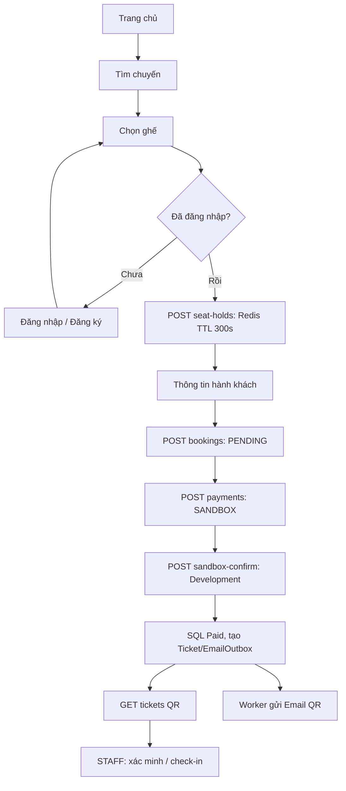

# KIẾN TRÚC VÀ LUỒNG FRONTEND – BUSGO

## Công nghệ
- React + Vite + React Router + Lucide Icons + CSS thuần.
- Tên biến/hàm chính dùng tiếng Việt không dấu (`maChuyen`, `danhSachMaGhe`, `datVe`, `taiKhoan`), phù hợp DTO backend.
- Frontend **không kết nối SQL Server, Redis, SMTP hay QRCoder trực tiếp**. Mọi request được gọi qua ASP.NET Core API.
- Không lưu vé/giá trị thanh toán chính thức trên trình duyệt. Giá và tình trạng ghế luôn do Backend kiểm tra.

## Luồng nghiệp vụ

## Route chính
| URL | Thành phần | Bảo vệ |
|---|---|---|
| `/` | TrangChu | Công khai |
| `/tim-chuyen` | TimChuyen | Công khai |
| `/chuyen/:maChuyen/chon-ghe` | ChonGhe | Xem công khai; giữ ghế yêu cầu login |
| `/dang-nhap`, `/dang-ky` | Auth | Công khai |
| `/thanh-toan/:maDatVe` | ThanhToan | JWT |
| `/don-cua-toi`, `/don/:maDatVe` | Đơn đặt vé | JWT |
| `/ve/:maVe` | ChiTietVe | JWT, kiểm tra chủ vé ở Backend |
| `/tai-khoan` | Tài khoản | JWT |
| `/quan-tri` | Bảng quản trị | ADMIN/STAFF |
| `/soat-ve` | Check-in QR | ADMIN/STAFF |

## Thiết kế responsive
- Desktop >= 1080px: nav ngang, hero 2 cột, kết quả 2 cột, booking 2 cột.
- Tablet 801–1080px: giảm khoảng cách, thẻ feature 2 cột.
- Mobile <= 800px: bottom navigation, menu bật/tắt, form/chuyến/booking 1 cột.
- Mobile <= 520px: nút bấm lớn, bảng admin cuộn ngang, modal cuộn dọc, phần đặt vé 1 cột.
- Hỗ trợ `prefers-reduced-motion`, focus keyboard, label cho nút và trường nhập.

## Bảo mật và giới hạn
- JWT lưu trong `sessionStorage` cho mục tiêu **demo local**. Khi đưa lên production nên thay bằng BFF + cookie HttpOnly/Secure/SameSite và chính sách CSRF.
- `sandbox-confirm` chỉ được Backend chấp nhận ở môi trường Development. Không đưa khóa webhook lên frontend.
- Phần camera `BarcodeDetector` chỉ hoạt động trên trình duyệt hỗ trợ, khi dùng HTTPS hoặc localhost; luôn có phương án nhập QR thủ công.
- Gửi email là bất đồng bộ qua backend EmailOutbox; không được hiển thị khẳng định mail đã đến hộp thư ngay sau thanh toán.
- Hệ thống bản demo không tích hợp thanh toán ngân hàng thực tế.
